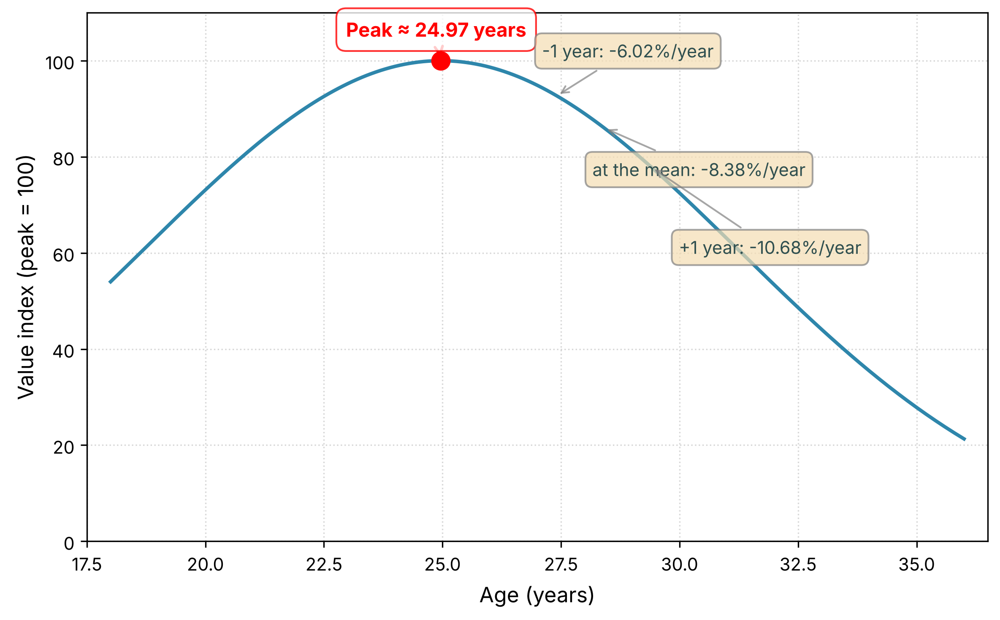

# Market value of midfielders in the 2025 Brazilian Série A

Python reproduction of the econometric model in my undergraduate thesis in Economics (UFSC, 2025): a hedonic OLS regression of Transfermarkt market value on age and on-pitch performance for the 87 midfielders of the 2025 Brazilian Série A.

The original estimation was done in Gretl. This repository re-estimates it from the processed data and checks every coefficient, standard error and fit statistic against the published table.



## Model and result

```
ln(MarketValue) = β0 + β1·AgeC + β2·AgeC² + β3·xG(+/-) + β4·MinPerMatch + ε
```

`AgeC` is age centered on the midfielder mean (28.4 years). N = 87, classical standard errors.

| Variable | Coefficient | SE | p-value |
|---|---|---|---|
| Constant | 14.3035 | 0.3368 | <0.001 |
| AgeC | −0.0875 | 0.0244 | <0.001 |
| AgeC² | −0.0127 | 0.0046 | 0.007 |
| xG(+/-) | 0.0406 | 0.0198 | 0.043 |
| MinPerMatch | 0.0066 | 0.0053 | 0.214 |

R² = 0.227, adjusted R² = 0.189, F(4, 82) = 6.00 (p < 0.001).

- **Age.** Value peaks at 24.97 years. The annual rate of change, exp(β1 + 2·β2·AgeC) − 1, is −8.4% at the mean age, −10.7% one year above it and −6.0% one year below it: past the peak, depreciation accelerates with age.
- **xG(+/-).** One additional unit of net expected-goal balance is associated with about 4.1% higher market value.
- **Minutes per match.** The point estimate is +0.7% per minute (p = 0.214). The thesis interprets it at a 78% confidence level, a threshold chosen with the advisor; at conventional levels it is not significant.

Diagnostics reported in the thesis (Appendix A): RESET p = 0.19, White p = 0.32, residual normality p = 0.078, Chow p = 0.47, VIF between 1.03 and 1.28.

### What the model does not identify

The coefficients are conditional associations, not causal effects. The specification has four regressors and no controls for club, contract length, nationality or international exposure, all of which the literature links to market value, so the age and xG terms can absorb part of their effect. The dependent variable is a Transfermarkt estimate, not an observed transfer fee. The sample is one league, one half-season and one position.

## Reproduction

```bash
pip install -r requirements.txt
for s in src/0*.py; do python "$s"; done
```

`src/03_estimate_midfielder_model.py` writes `outputs/midfielder_model.txt`. Reproduction criteria were fixed before running: identical N, coefficient relative error below 1e-4, standard error relative error below 1e-3, R² equal to the fourth decimal. Result: largest relative error 3.8e-06 for a coefficient and 1.8e-06 for a standard error; N, R², adjusted R² and F identical.

Getting there required one data correction: the estimation file had been overwritten a month after the Gretl session, with one cell of xG replaced by the string `"x "`. Details in [`docs/methodology.md`](docs/methodology.md).

## Repository

| Path | Contents |
|---|---|
| `thesis/` | Defended thesis (PDF, in Portuguese), original Gretl command log, Figure 2 as printed |
| `data/` | Processed base: all players (`df_final.csv`, 283), midfielder sample (`df_mc.csv`, 87), other positions, and the checkpoint they are built from |
| `src/` | Five scripts, run in order: split by position, check full sample, estimate model, LaTeX tables, age curve |
| `outputs/` | Everything generated by `src/`, never edited by hand |
| `docs/methodology.md` | Sources, collection dates, data provenance, known gaps |
| `legacy/` | Exploratory work not in the published result: per-position models, clustering, RNC club ranking, earlier merge attempts |

## Data

Market values from [Transfermarkt](https://www.transfermarkt.com/) and performance data from [FBref](https://fbref.com/), 2025 Série A through matchday 20, collected in August and September 2025. Only the processed base needed to reproduce the result is included, for academic use. It is derived from those sites and is not covered by the MIT license, which applies to the code only. Raw dumps and scrapers are not included; see [`docs/methodology.md`](docs/methodology.md).

## Citation

Hüttl Marques, I. (2025). *Mensuração de determinantes de valor no mercado de transferências do futebol brasileiro: um estudo sobre a valoração dos atletas da posição de meio-campo da Série A do Campeonato Brasileiro Masculino de 2025*. Undergraduate thesis, Universidade Federal de Santa Catarina.

Repository organization and reproduction scripts were built with assistance from Claude Code.
